# HariMarket

**A pick-up based campus marketplace for Pamantasan ng Lungsod ng Maynila (PLM).**

Student sellers list products, buyers order them, and the item is collected at the seller's
pick-up point on campus. Payment is made in person and there is no delivery. Every new account
and every product listing is reviewed by an administrator before it goes live, and pick-ups are
confirmed with a QR code.

> Web Systems Technology final project (BSIT, individual) — Pamantasan ng Lungsod ng Maynila

**Live demo:** https://harimarket.ifree.page

---

## Table of contents
1. [Features](#features)
2. [Technologies](#technologies)
3. [Screenshots](#screenshots)
4. [Installation](#installation)
5. [Database setup](#database-setup)
6. [Project structure](#project-structure)
7. [Security](#security)
8. [Testing](#testing)
9. [Deployment](#deployment)
10. [Developers](#developers)

## Features

**Accounts and roles**
- Three roles: **Buyer**, **Seller** and **Administrator**, with role-based access control on every page.
- Registration with admin approval; sellers also upload their SER (Student Enrollment Record).
- Passwords hashed with bcrypt (`password_hash`), sessions with ID regeneration on login.
- "Forgot password" flow: the admin issues a temporary password that must be changed at the next login.

**Marketplace**
- Browse, **live search** (Fetch API), category filter and sorting.
- Database-backed cart, grouped by seller; **one order per seller**, each with that seller's pick-up point.
- Order status: *Placed → Preparing → Ready for Pick-up → Picked Up* (or *Cancelled*, which restores stock).
- Stock is locked inside a database transaction at checkout so two buyers cannot take the last item.
- Reviews and ratings, allowed only after an order is **Picked Up**.
- Buyer-to-seller **order chat**, in-app notifications, and product/user **reports**.

**QR pick-up**
- The buyer receives a pick-up code and QR code after checkout.
- The seller scans the QR with the **device camera** (or types the code) to mark the order Picked Up.

**Seller tools**
- Product CRUD with photo upload, pick-up point/hours/note settings, order management, sales charts.

**Admin tools**
- Approve or reject registrations, seller applications and product listings.
- Manage users (terminate accounts, issue temporary passwords), handle reports.
- Pick-up location CRUD, system analytics charts.

**Modern web features**
- Dark / light mode saved in `localStorage`
- Live notifications and unread badges (polling the Fetch API every 15 seconds, with back-off)
- Live search with debouncing
- QR code generation and camera-based QR scanning
- Camera / file upload with server-side validation
- Charts and dashboards (Chart.js)
- Offline / connection-problem banner

## Technologies

| Layer | Technology |
|---|---|
| Front end | HTML5, CSS3 (responsive, custom stylesheet), JavaScript ES6+ (arrow functions, template literals, destructuring, `async`/`await`, Fetch API) |
| Back end | PHP 8 with PDO |
| Database | MySQL / MariaDB |
| Libraries | Chart.js 4, qrcode-generator, html5-qrcode, Iconoir icons, Google Fonts (Inter) |
| Tools | Git and GitHub, Visual Studio Code, XAMPP, browser developer tools |
| Hosting | InfinityFree (PHP + MySQL free tier) |

## Screenshots

| | |
|---|---|
| 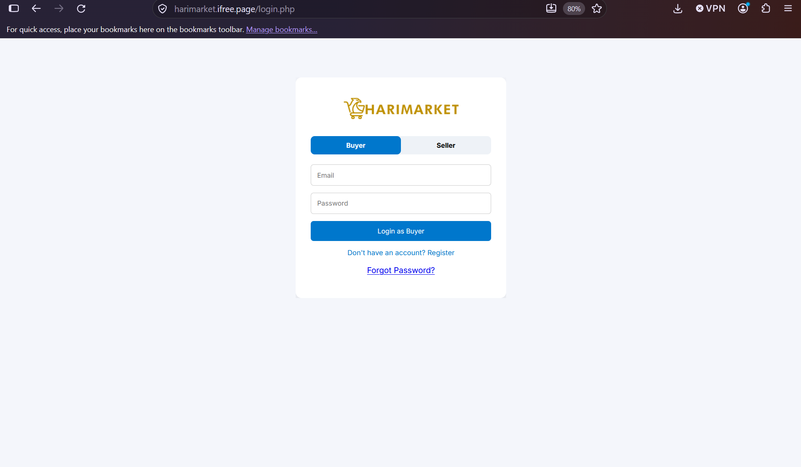 **Login** | 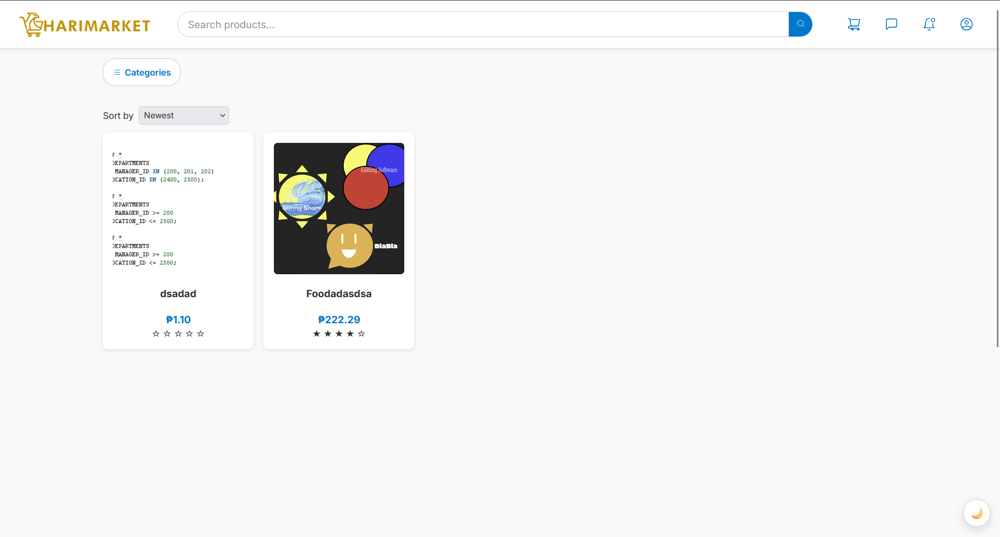 **Home with live search** |
| 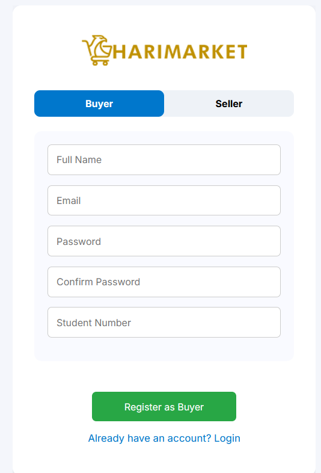 **Buyer registration** | 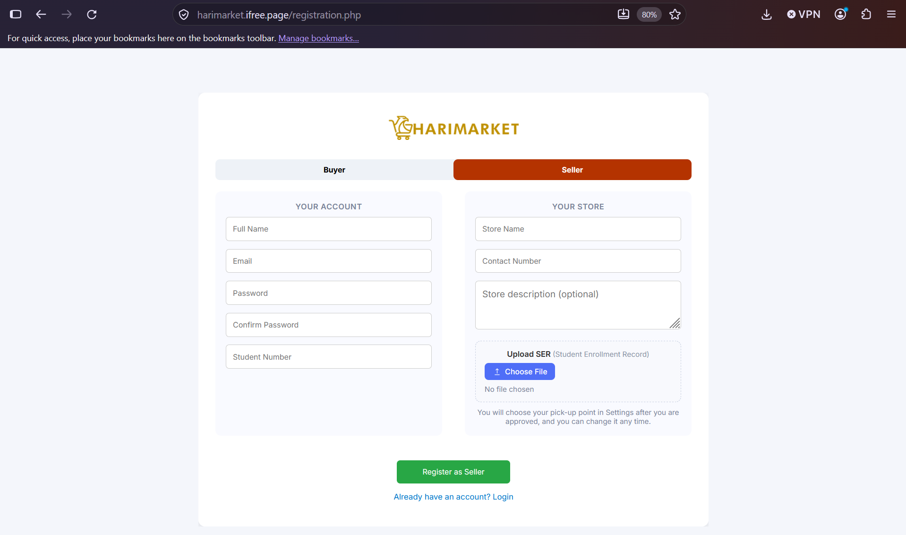 **Seller registration** |
| 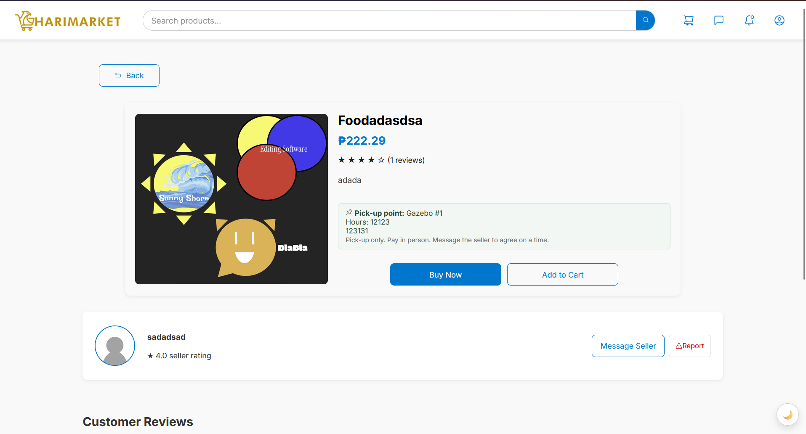 **Product page** | 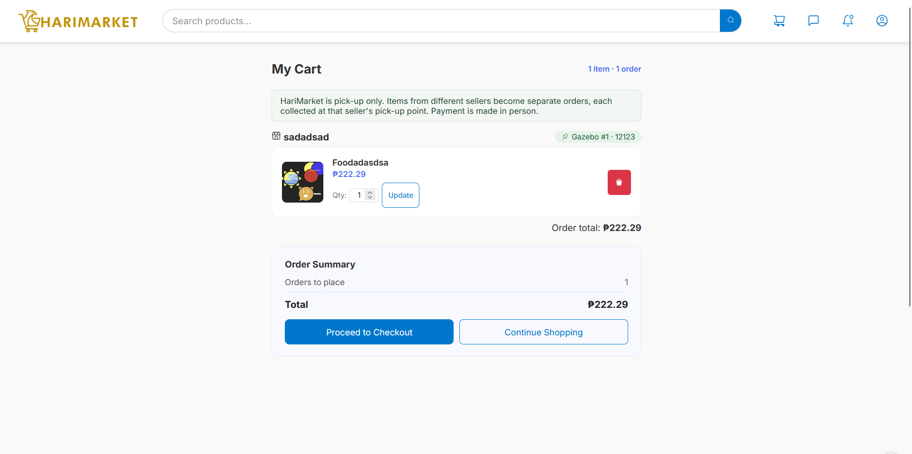 **Cart grouped by seller** |
| 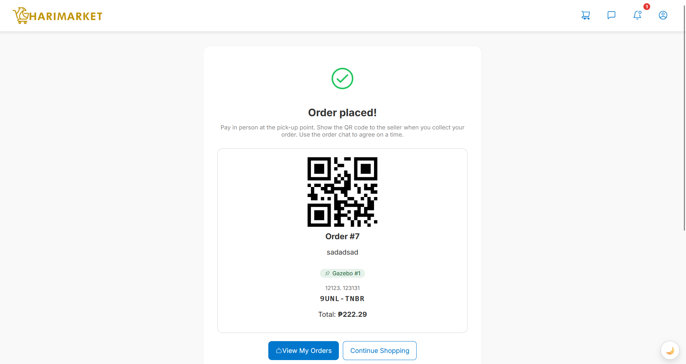 **Order confirmation with QR** | 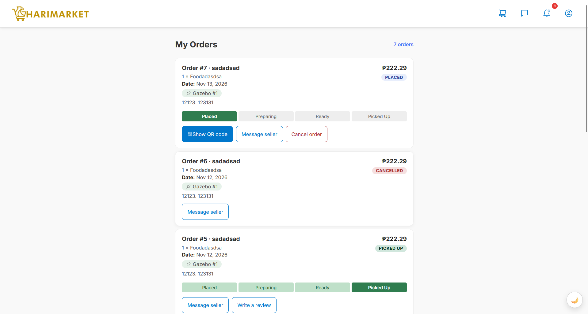 **My orders** |
| 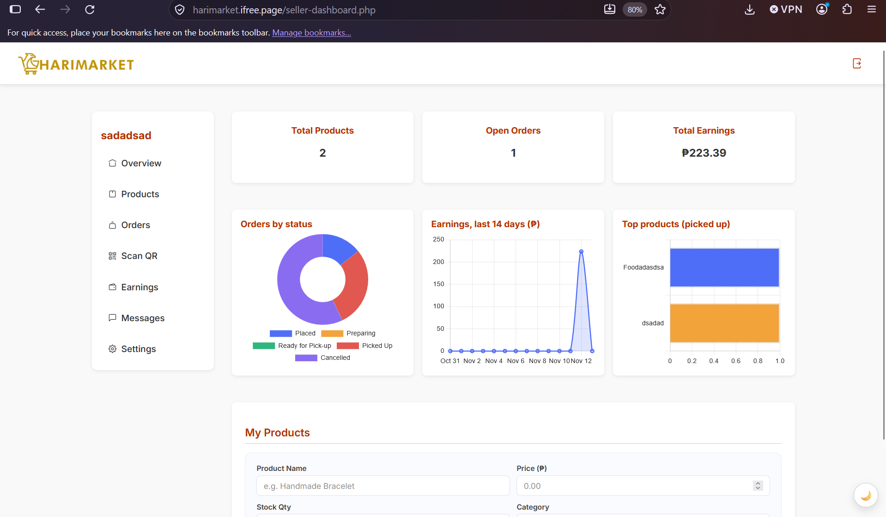 **Seller dashboard** | 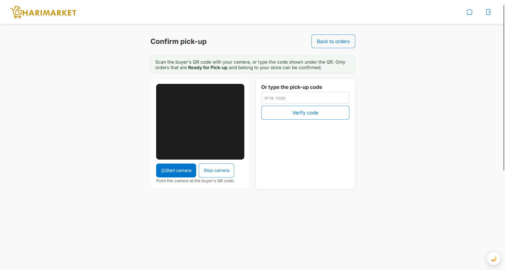 **Seller QR scan** |
| 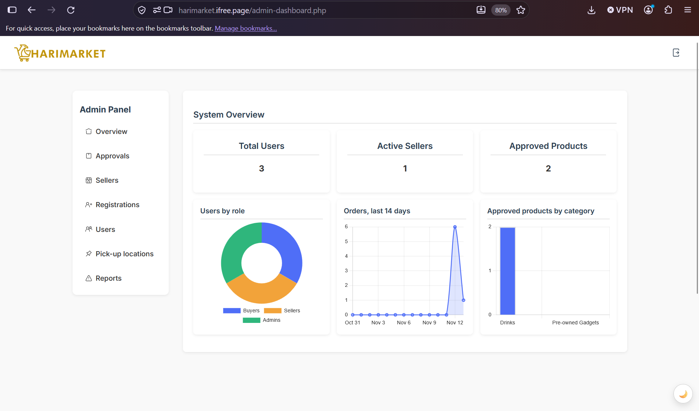 **Admin dashboard** | 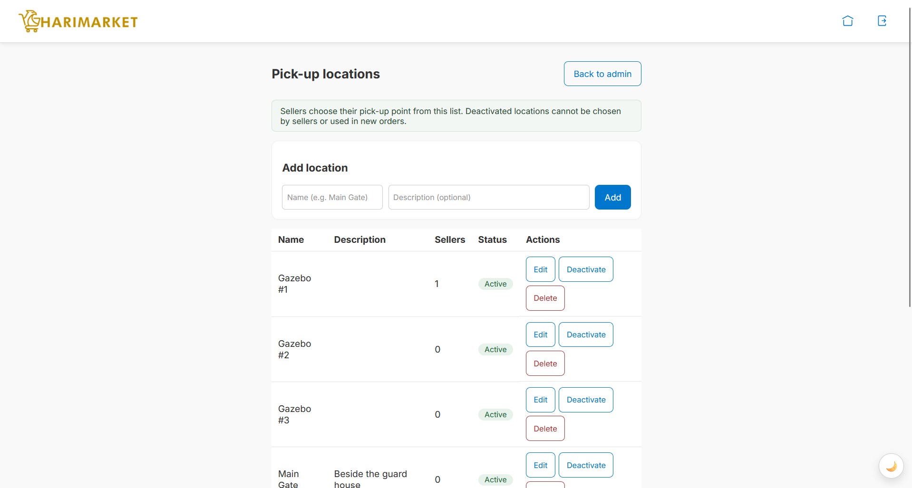 **Pick-up locations (admin CRUD)** |
| 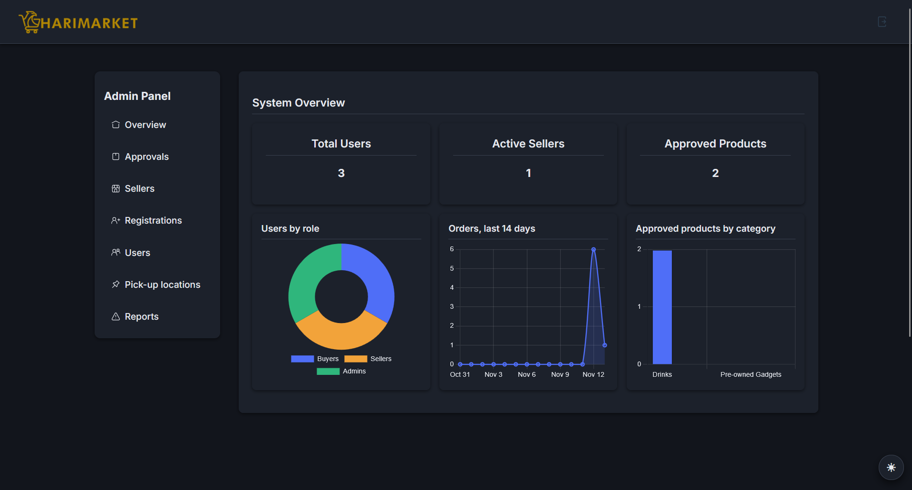 **Dark mode** | 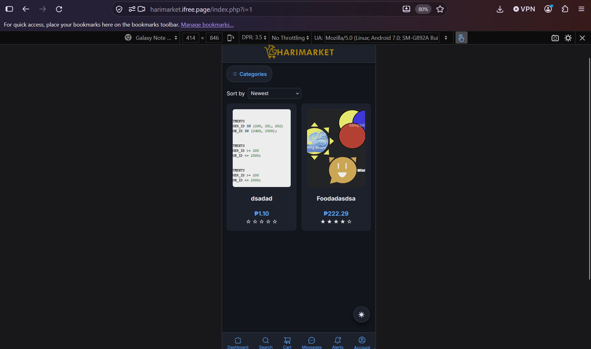 **Mobile layout** |

Diagrams (architecture, use case, flowcharts, ERD, wireframes) are in [`docs/diagrams/`](docs/diagrams).

## Installation

Requirements: PHP 8.0+ with the `pdo_mysql` and `fileinfo` extensions, and MySQL or MariaDB.
XAMPP provides all of these.

```bash
git clone https://github.com/heavenlyloaf/harimarket.git
```

1. Copy the `harimarket` folder into XAMPP's `htdocs` folder (or serve it with the built-in server:
   `php -S localhost:8000 -t harimarket`).
2. Create and import the database (see [Database setup](#database-setup)).
3. Copy `harimarket/config/config.example.php` to `harimarket/config/config.php` and enter your
   database details. This file is git-ignored; never commit it.
4. Create the first administrator (the password is never stored in the repository):
   ```bash
   php harimarket/tools/create_admin.php
   ```
5. Open the site. Register a seller and a buyer, then approve them from the admin dashboard at
   `/admin-login.php`.
6. Make sure `harimarket/uploads/` is writable by the web server. It contains an `.htaccess` file
   that blocks script execution in that folder.

## Database setup

The full schema (12 tables, constraints and reference data) is in
[`harimarket/sql/database.sql`](harimarket/sql/database.sql). It contains **no user accounts**.

**Option A – command line**
```bash
mysql -u root -p < harimarket/sql/database.sql
```
The script creates the `harimarket` database, all tables, the five product categories and three
sample pick-up locations.

**Option B – phpMyAdmin**
1. Create an empty database named `harimarket` (collation `utf8mb4_unicode_ci`).
2. Select it, open **Import**, and choose `database.sql`.

**Shared hosting (e.g. InfinityFree):** the host creates the database for you and does not allow
`CREATE DATABASE`/`USE`. Delete those two lines at the top of the file, select your database in
phpMyAdmin, and import. Put the host, database name, user and password in `config/config.php`.

Tables: `users`, `seller_profiles`, `pickup_locations`, `categories`, `products`, `cart`, `orders`,
`order_items`, `messages`, `notifications`, `reviews`, `reports`. See `docs/diagrams/erd.png`.

## Project structure

```
harimarket/
├── harimarket/            Application (this is what is served by the web server)
│   ├── *.php              Pages (index, login, registration, product, cart, checkout, orders, ...)
│   ├── api/               JSON endpoints: products.php, notifications.php, stats.php
│   ├── config/            config.example.php (config.php is git-ignored)
│   ├── css/  js/          Stylesheets and scripts (js/vendor holds third-party libraries)
│   ├── partials/          Shared head, navbar, bottom navigation, footer, alerts
│   ├── sql/database.sql   Database schema and reference data
│   ├── tools/             create_admin.php (command-line only)
│   └── uploads/           User uploads (contents are git-ignored; .htaccess blocks PHP execution)
└── docs/
    ├── diagrams/          Architecture, use case, flowcharts, ERD, wireframes
    └── screenshots/       Screens used in this README
```

## Security

- PDO prepared statements everywhere (SQL injection prevention)
- Output escaping with `htmlspecialchars` / `textContent` (XSS prevention)
- CSRF token on every POST form and `fetch()` request
- bcrypt password hashing, session cookie flags (`HttpOnly`, `SameSite`, `Secure` on HTTPS) and `session_regenerate_id`
- Role checks on every protected page and API endpoint
- Upload validation: size limit, real MIME type check, image content check, random file names
- Uploads folder cannot execute PHP; credentials live in a git-ignored `config/config.php`

## Testing

28 test cases were run on the deployed site covering registration and approval, the seller and buyer
flows, QR pick-up, role-based access, dark mode, charts, mobile layout and the offline banner.
All passed (one after a fix). Details are in Chapter 4 of the project documentation.

## Deployment

Hosted on InfinityFree (free PHP + MySQL hosting). The contents of `harimarket/` are uploaded to the
`htdocs` folder, the database is imported with phpMyAdmin, and `config/config.php` is created on the
server with the hosting database details.

## Developers

| Name | Role and contributions |
|---|---|
| **Prince Heaven P. Lapaz** ([@heavenlyloaf](https://github.com/heavenlyloaf)) — BSIT 2-4, 2024-11529 | Sole developer: system analysis and design, UI/UX and wireframes, front-end, back-end, database design, API/Fetch integration, testing, deployment and documentation |

## Acknowledgements

Chart.js (MIT), qrcode-generator by Kazuhiko Arase (MIT), html5-qrcode (Apache-2.0), Iconoir icons (MIT),
Inter typeface via Google Fonts (OFL).
